# Retro na Windows – instrukcja

Retro to domowa biblioteka gier retro. Gry przeglądasz w przeglądarce (RomM) na tym komputerze, telefonie lub telewizorze, a na komputerze możesz też w nie grać (ES-DE i RetroArch, z padem).

## Czego potrzebujesz

- Windows 10 22H2 lub Windows 11, 64-bit
- co najmniej 8 GB pamięci RAM
- połączenie z internetem i około 30 minut
- około 4 GB wolnego miejsca na dysku C: oraz miejsce na gry

## 1. Pobierz instalator

Pobierz plik **RetroSetup.exe** ze strony [github.com/PawelWywiol/retro/releases/latest](https://github.com/PawelWywiol/retro/releases/latest) (sekcja _Assets_) i uruchom go dwuklikiem.

## 2. Ostrzeżenie Windows

Windows pokaże okno **„System Windows ochronił ten komputer”**, bo instalator nie ma płatnego podpisu cyfrowego. Kliknij **Więcej informacji**, a potem **Uruchom mimo to**.

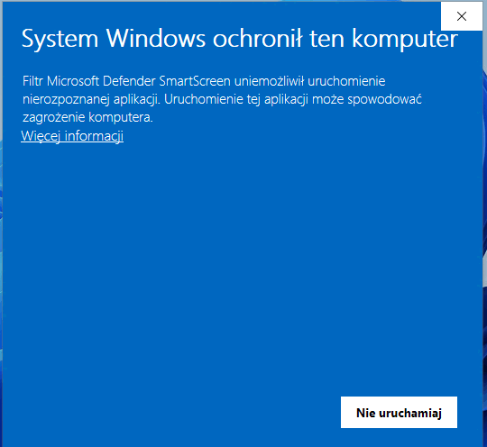
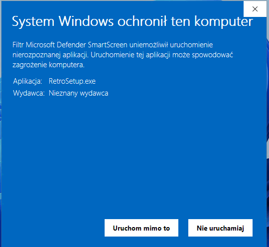

Następnie zatwierdź okno **„Czy chcesz zezwolić tej aplikacji na wprowadzanie zmian?”** przyciskiem **Tak**.

## 3. Kreator instalacji

Na każdej stronie klikasz **Dalej**. Pola opcjonalne możesz zostawić puste.

| Strona | Co zrobić |
|---|---|
| Informacja | przeczytaj i kliknij **Dalej** |
| Lokalizacja docelowa | folder Retro, domyślnie `C:\Retro` |
| Folder z grami | gdzie mają być gry; może być na innym dysku, np. `D:\Gry` |
| Pobieranie gier przez VPN | tylko jeśli masz konto VPN (WireGuard); inaczej zostaw puste |
| Okładki i opisy gier | login i hasło z [screenscraper.fr](https://www.screenscraper.fr) – opcjonalne |
| Zadania dodatkowe | **Granie na tym komputerze** – zostaw zaznaczone, jeśli chcesz grać na tym PC |
| Gotowy do rozpoczęcia instalacji | sprawdź ustawienia i kliknij **Instaluj** |

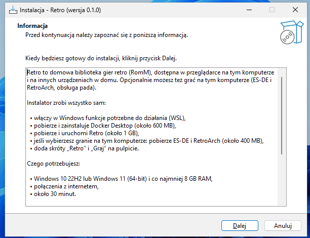
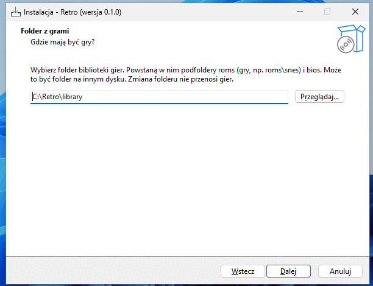
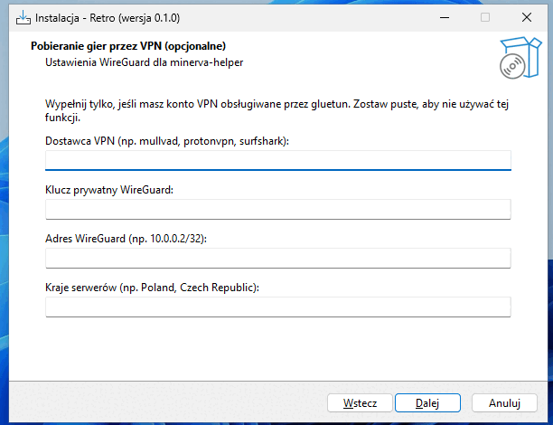
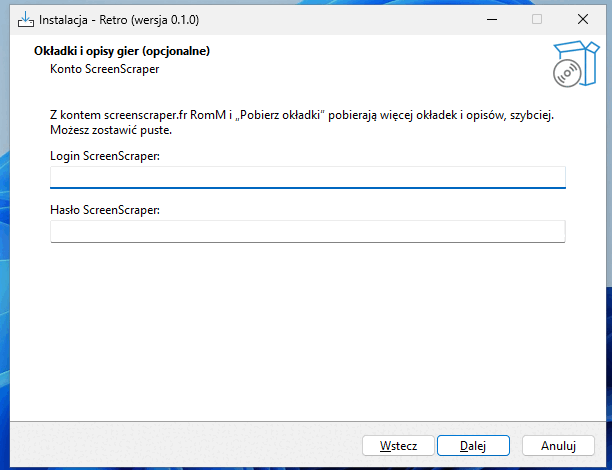
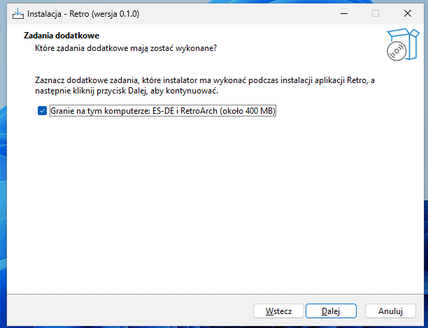
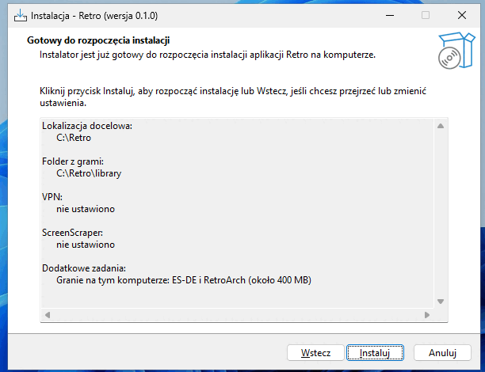

Po kliknięciu **Instaluj** otworzy się czarne okno **„Retro - konfiguracja”**. Nie zamykaj go – samo się zamknie.

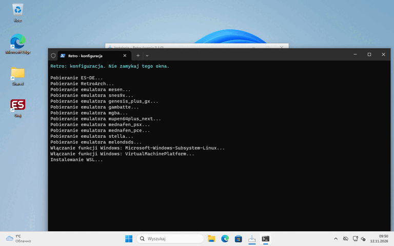

## 4. Ponowne uruchomienie

Przy pierwszej instalacji kreator poprosi o ponowne uruchomienie komputera. Zostaw **Tak, uruchom ponownie teraz** i kliknij **Zakończ**.

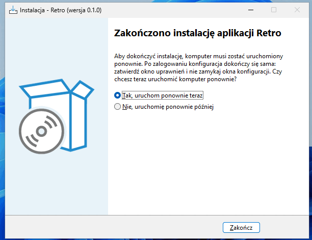

Po zalogowaniu:

1. zatwierdź okno uprawnień przyciskiem **Tak**,
2. poczekaj, aż okno **„Retro - konfiguracja”** skończy pracę (za pierwszym razem pobiera około 1 GB),
3. otworzy się przeglądarka z RomM.

## 5. Pierwsze uruchomienie RomM

W przeglądarce otworzy się kreator RomM: przejdź go i **utwórz konto administratora** (login i hasło zapamiętaj). Później RomM otworzysz skrótem **Retro** na pulpicie.

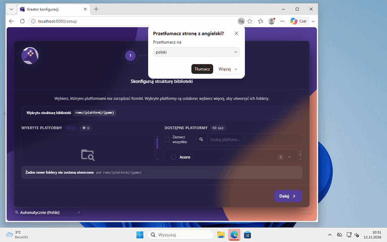

## 6. Dodawanie gier

Gry wrzucaj do podfolderów w folderze z grami, np. `D:\Gry\roms\snes`. Nazwy podfolderów:

| System | Folder |
|---|---|
| NES / Pegasus | `nes` |
| SNES | `snes` |
| Sega Mega Drive | `megadrive` |
| Sega Master System | `mastersystem` |
| Game Boy / Color / Advance | `gb`, `gbc`, `gba` |
| Nintendo 64 | `n64` |
| Nintendo DS | `nds` |
| PlayStation | `psx` |
| PC Engine | `pcengine` |
| Atari 2600 | `atari2600` |

Pliki BIOS (np. do PlayStation) wrzucaj do folderu `bios`. Potem uruchom w RomM skanowanie biblioteki (_Scan_).

## 7. Okładki i opisy

Menu Start → **Retro** → **Pobierz okładki**. Przy dużej bibliotece trwa to długo. Na koniec w RomM uruchom skanowanie ze źródłem **Gamelist**.

## 8. Granie na komputerze

Skrót **Graj** na pulpicie uruchamia ES-DE. Pada podłącz przed uruchomieniem. Wyjście z gry: dwa razy _Start_ + _Select_ na padzie albo dwa razy klawisz **Esc**.

## 9. Inne urządzenia w domu

Na telefonie lub telewizorze wpisz w przeglądarce `http://NAZWA-KOMPUTERA:8080` (nazwę znajdziesz w Ustawienia → System → Informacje).

Jeśli nie działa, ustaw sieć jako prywatną: Ustawienia → Sieć i Internet → Wi-Fi lub Ethernet → właściwości sieci → typ profilu sieciowego **Sieć prywatna**.

## 10. Menu Start

W menu Start, w folderze **Retro**, znajdziesz:

- **Ustawienia Retro** – zmiana folderu z grami, VPN i konta ScreenScraper
- **Pobierz okładki**
- **Kopia zapasowa Retro** – kopia biblioteki RomM (robi się też sama codziennie o 20:00)
- **Przywróć kopię Retro** – przywraca ostatnią kopię (trzeba wpisać `TAK`)
- **Gry** – otwiera folder z grami
- **Graj** – ES-DE

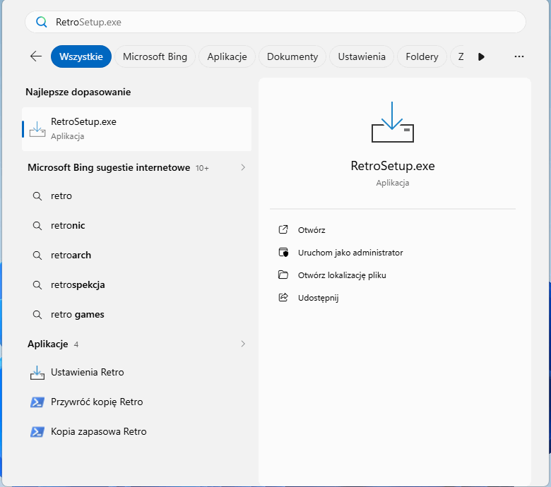

## Problemy

- **„Wirtualizacja jest wyłączona”** – włącz ją w ustawieniach BIOS/UEFI komputera: uruchom komputer ponownie, wciśnij klawisz ustawień (najczęściej **Del**, **F2** lub **F10**) i włącz opcję **Intel VT-x**, **Intel Virtualization Technology**, **AMD-V** lub **SVM Mode**. Potem uruchom instalator jeszcze raz.
- **Docker Desktop prosi o zalogowanie** – nie trzeba; okno można zamknąć.
- **Coś nie działa** – uruchom **Ustawienia Retro** i przejdź kreator jeszcze raz. Szczegóły błędu są w pliku `C:\Retro\app\install.log`.

## Odinstalowanie

Ustawienia → Aplikacje → **Retro** → Odinstaluj. Gry, dane i kopie zapasowe zostają na dysku. Docker Desktop i WSL odinstalowuje się osobno.
