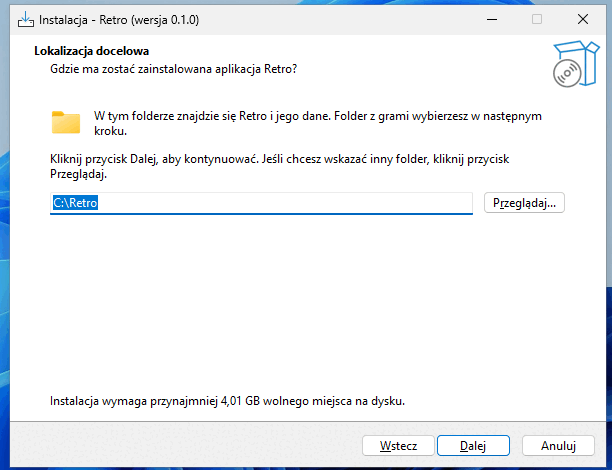

# Retro na Windows – instrukcja

Retro to domowa biblioteka gier retro. Gry przeglądasz w przeglądarce (RomM) na tym komputerze, telefonie lub telewizorze, a na komputerze możesz też w nie grać (ES-DE i RetroArch, z padem).

## Czego potrzebujesz

- Windows 10 22H2 lub Windows 11, 64-bit
- co najmniej 8 GB pamięci RAM
- połączenie z internetem i około 30 minut
- około 4 GB wolnego miejsca na dysku C: oraz miejsce na gry

## 1. Pobierz instalator

Pobierz plik **RetroSetup.exe** ze strony [github.com/PawelWywiol/retro/releases/latest](https://github.com/PawelWywiol/retro/releases/latest) (sekcja _Assets_) i uruchom go dwuklikiem.

## 2. Ostrzeżenie Windows

Windows pokaże okno **„System Windows ochronił ten komputer”**, bo instalator nie ma płatnego podpisu cyfrowego. Kliknij **Więcej informacji**, a potem **Uruchom mimo to**.

Następnie zatwierdź okno **„Czy chcesz zezwolić tej aplikacji na wprowadzanie zmian?”** przyciskiem **Tak**.

## 3. Kreator instalacji

Na każdej stronie klikasz **Dalej**. Pola opcjonalne możesz zostawić puste.

| Strona | Co zrobić |
|---|---|
| Informacja | przeczytaj i kliknij **Dalej** |
| Lokalizacja docelowa | folder Retro, domyślnie `C:\Retro` |
| Folder z grami | gdzie mają być gry; może być na innym dysku, np. `D:\Gry` |
| Pobieranie gier przez VPN | tylko jeśli masz konto VPN (WireGuard); inaczej zostaw puste |
| Okładki i opisy gier | login i hasło z [screenscraper.fr](https://www.screenscraper.fr) – opcjonalne |
| Zadania dodatkowe | **Granie na tym komputerze** – zostaw zaznaczone, jeśli chcesz grać na tym PC |
| Gotowy do rozpoczęcia instalacji | sprawdź ustawienia i kliknij **Instaluj** |

Po kliknięciu **Instaluj** otworzy się czarne okno **„Retro - konfiguracja”**. Nie zamykaj go – samo się zamknie.

## 4. Ponowne uruchomienie

Przy pierwszej instalacji kreator poprosi o ponowne uruchomienie komputera. Zostaw **Tak, uruchom ponownie teraz** i kliknij **Zakończ**.

Po zalogowaniu:

1. zatwierdź okno uprawnień przyciskiem **Tak**,
2. poczekaj, aż okno **„Retro - konfiguracja”** skończy pracę (za pierwszym razem pobiera około 1 GB),
3. otworzy się przeglądarka z RomM.

## 5. Pierwsze uruchomienie RomM

W przeglądarce otworzy się kreator RomM: przejdź go i **utwórz konto administratora** (login i hasło zapamiętaj).

## Jak to działa

Retro działa w tle w programie **Docker Desktop**, który uruchamia się sam po zalogowaniu do Windows (ikona wieloryba przy zegarze). Nie trzeba niczego włączać: po kilku minutach od zalogowania RomM i Minerva są gotowe. Wszystko otwierasz w przeglądarce:

| Co | Do czego | Adres na tym komputerze | Skrót |
|---|---|---|---|
| **RomM** | przeglądanie biblioteki, okładki, granie w przeglądarce | `http://localhost:8080` | **Retro** na pulpicie |
| **Minerva** | wyszukiwanie i pobieranie gier przez VPN (tylko jeśli podałeś klucz VPN) | `http://localhost:8090` | **Minerva** na pulpicie |
| **ES-DE** | granie na tym komputerze z padem | – | **Graj** na pulpicie |
| **Pliki** | przeglądanie, wgrywanie, kopiowanie, przenoszenie i usuwanie plików w folderze z grami | `http://localhost:8070` | menu Start → **Pliki Retro** |

Jeśli strona się nie otwiera, sprawdź, czy Docker Desktop działa (menu Start → Docker Desktop), i odczekaj minutę.

## 6. RomM – biblioteka gier

Otwórz skrót **Retro** i zaloguj się kontem z punktu 5.

Gry wrzucaj do podfolderów w folderze z grami (menu Start → **Gry Retro**), np. `D:\Gry\roms\snes`. Nazwy podfolderów:

| System | Folder |
|---|---|
| NES / Pegasus | `nes` |
| SNES | `snes` |
| Sega Mega Drive | `megadrive` |
| Sega Master System | `mastersystem` |
| Game Boy / Color / Advance | `gb`, `gbc`, `gba` |
| Nintendo 64 | `n64` |
| Nintendo DS | `nds` |
| PlayStation | `psx` |
| PC Engine | `pcengine` |
| Atari 2600 | `atari2600` |

Pliki BIOS (np. do PlayStation) wrzucaj do folderu `bios`. Po dodaniu gier uruchom w RomM skanowanie biblioteki (_Scan_), inaczej nowe gry się nie pokażą.

## 7. Minerva – pobieranie gier

Minerva działa tylko wtedy, gdy w kreatorze podałeś dane VPN. Cały jej ruch idzie przez VPN, a gdy VPN się rozłączy, pobieranie się zatrzymuje.

1. Otwórz skrót **Minerva**.
2. Za pierwszym razem kliknij **Pobierz katalog** (około 1,7 GB, kilka minut, tylko raz).
3. Znajdź grę w **Szukaj** albo **Przeglądaj** i kliknij przycisk pobierania. Postęp widać w **Kolejka**.
4. Pobrana gra trafia od razu do właściwego folderu `roms\<system>`. W RomM uruchom skanowanie (_Scan_), a w ES-DE gra pojawi się po ponownym uruchomieniu.

### Czy VPN działa?

W Minerva otwórz **Ustawienia** → **Sprawdź VPN**:

- **„Pobieranie idzie przez VPN.”** – wszystko w porządku; **Adres publiczny**, **Lokalizacja** i **Dostawca** pokazują serwer VPN, a nie Twój dom i operatora internetu;
- **„Stan VPN: …”** albo **„Nie znaleziono VPN”** – VPN nie jest połączony, pobieranie jest wstrzymane. Sprawdź dane VPN (punkt 9) albo uruchom komputer ponownie;
- strona Minerva się nie otwiera – VPN nie jest skonfigurowany albo Docker Desktop nie działa.

## 7a. Pliki – zarządzanie folderem z grami

Menu Start → **Pliki Retro** (albo `http://localhost:8070`) otwiera menedżer plików w przeglądarce. Działa też z telefonu i innego komputera (`http://ADRES-IP:8070`, punkt 11), więc gry można wgrać bez kopiowania na pendrive.

- **Login:** `admin`
- **Hasło:** otwórz w Notatniku plik `C:\Retro\app\.env` i skopiuj wartość z linii `FILEBROWSER_ADMIN_PASSWORD=` (wszystko po znaku `=`). Hasło jest nadawane przy każdym uruchomieniu Retro, więc zmienia się je tylko w tym pliku, a potem przez **Ustawienia Retro**.

Gry wgrywaj do `roms\<system>` (nazwy folderów w punkcie 6), a potem uruchom skanowanie w RomM.

## 8. Okładki i opisy

Menu Start → **Pobierz okładki Retro** (wpisz w menu Start „okładki” albo „retro”). Okładki trafiają do folderu z grami, więc widzi je i RomM, i ES-DE. Przy dużej bibliotece trwa to długo. Na koniec w RomM uruchom skanowanie ze źródłem **Gamelist**, a ES-DE uruchom ponownie.

## 9. Dodanie lub zmiana VPN i konta ScreenScraper

Klucze VPN i konto ScreenScraper możesz dodać w dowolnym momencie, także jeśli przy instalacji zostawiłeś te pola puste. Nie trzeba niczego instalować od nowa.

### Przygotuj dane VPN

Minerva potrzebuje konta VPN z obsługą WireGuard, np. Mullvad, Proton VPN, NordVPN lub Surfshark ([pełna lista](https://github.com/qdm12/gluetun-wiki/tree/main/setup/providers)).

1. Zaloguj się na stronie swojego dostawcy VPN i wygeneruj ręczną konfigurację **WireGuard** (szukaj opcji typu _WireGuard configuration_ / _manual setup_). Pobierzesz plik `.conf`.
2. Otwórz go w Notatniku. Potrzebne są dwie linie z sekcji `[Interface]`:
   - `PrivateKey = …` – to jest **klucz prywatny**,
   - `Address = …` – to jest **adres**, np. `10.0.0.2/32` (jeśli po przecinku jest drugi adres z dwukropkami, przepisz tylko pierwszy).

Klucz prywatny jest tajny jak hasło: nikomu go nie wysyłaj.

### Przygotuj konto ScreenScraper

Załóż darmowe konto na [screenscraper.fr](https://www.screenscraper.fr) i zapamiętaj login i hasło. Z kontem RomM i **Pobierz okładki** pobierają więcej okładek i opisów, szybciej.

### Wpisz dane

1. Menu Start → **Retro** → **Ustawienia Retro** (zatwierdź okno uprawnień przyciskiem **Tak**).
2. Klikaj **Dalej**. Kreator pokazuje obecne ustawienia, niczego nie zmieniaj na stronach, których nie dotyczy zmiana.
3. Strona **Pobieranie gier przez VPN**:
   - **Dostawca VPN** – nazwa małymi literami, np. `mullvad`, `protonvpn`, `nordvpn`, `surfshark`,
   - **Klucz prywatny WireGuard** – wartość `PrivateKey`,
   - **Adres WireGuard** – wartość `Address`,
   - **Kraje serwerów** – po angielsku, oddzielone przecinkami, np. `Poland, Germany`; puste oznacza dowolny kraj.
4. Strona **Okładki i opisy gier** – login i hasło ScreenScraper.
5. **Dalej** → **Instaluj**. Czarne okno **„Retro - konfiguracja”** zrobi kopię zapasową i uruchomi Retro ponownie z nowymi ustawieniami (bez restartu komputera), a na końcu otworzy RomM. Po pierwszym dodaniu VPN pobiera też programy VPN i Minerva, więc trwa dłużej.
6. Po dodaniu VPN otwórz Minerva (`http://localhost:8090`) i sprawdź połączenie: **Ustawienia** → **Sprawdź VPN** (punkt 7).

### Zmiana i wyłączenie

Tak samo przez **Ustawienia Retro** zmienisz klucz, kraje serwerów, konto ScreenScraper albo folder z grami (zmiana folderu nie przenosi gier, przenieś je sam). Żeby wyłączyć Minerva, wyczyść pole **Klucz prywatny WireGuard**.

## 10. Granie na komputerze (ES-DE)

Skrót **Graj** na pulpicie (albo menu Start → **Graj w Retro**) uruchamia ES-DE. Pada podłącz przed uruchomieniem. ES-DE pokazuje gry z tego samego folderu co RomM.

Wyjście z gry: dwa razy _Start_ + _Select_ na padzie albo dwa razy klawisz **Esc**.

## 11. Inne urządzenia w domu

Na telefonie, tablecie lub telewizorze wpisz w przeglądarce adres komputera:

- RomM: `http://ADRES-IP:8080`
- Minerva: `http://ADRES-IP:8090`
- Pliki: `http://ADRES-IP:8070`

Adres IP znajdziesz w Ustawienia → Sieć i Internet → Wi-Fi lub Ethernet → właściwości sieci → **Adres IPv4** (np. `192.168.1.20`). Zamiast adresu IP możesz spróbować nazwy komputera (Ustawienia → System → Informacje), ale nie każde urządzenie ją rozpozna.

Jeśli nie działa, ustaw sieć jako prywatną: w tym samym oknie właściwości sieci wybierz typ profilu sieciowego **Sieć prywatna**.

## 12. Menu Start

Najłatwiej otworzyć menu Start i wpisać „retro”. W folderze **Retro** (Wszystkie aplikacje) znajdziesz:

- **Retro** – RomM w przeglądarce
- **Ustawienia Retro** – zmiana folderu z grami, VPN i konta ScreenScraper
- **Pliki Retro** – menedżer plików folderu z grami (punkt 7a)
- **Pobierz okładki Retro** – okładki i opisy gier dla RomM i ES-DE
- **Kopia zapasowa Retro** – kopia biblioteki RomM (robi się też sama codziennie o 20:00)
- **Przywróć kopię Retro** – przywraca ostatnią kopię (trzeba wpisać `TAK`)
- **Gry Retro** – otwiera folder z grami
- **Graj w Retro** – ES-DE

## Problemy

- **„Wirtualizacja jest wyłączona”** – włącz ją w ustawieniach BIOS/UEFI komputera: uruchom komputer ponownie, wciśnij klawisz ustawień (najczęściej **Del**, **F2** lub **F10**) i włącz opcję **Intel VT-x**, **Intel Virtualization Technology**, **AMD-V** lub **SVM Mode**. Potem uruchom instalator jeszcze raz.
- **Docker Desktop prosi o zalogowanie** – nie trzeba; okno można zamknąć.
- **Coś nie działa** – uruchom **Ustawienia Retro** i przejdź kreator jeszcze raz. Szczegóły błędu są w pliku `C:\Retro\app\install.log`.

## Odinstalowanie

Ustawienia → Aplikacje → **Retro** → Odinstaluj. Gry, dane i kopie zapasowe zostają na dysku. Docker Desktop i WSL odinstalowuje się osobno.
